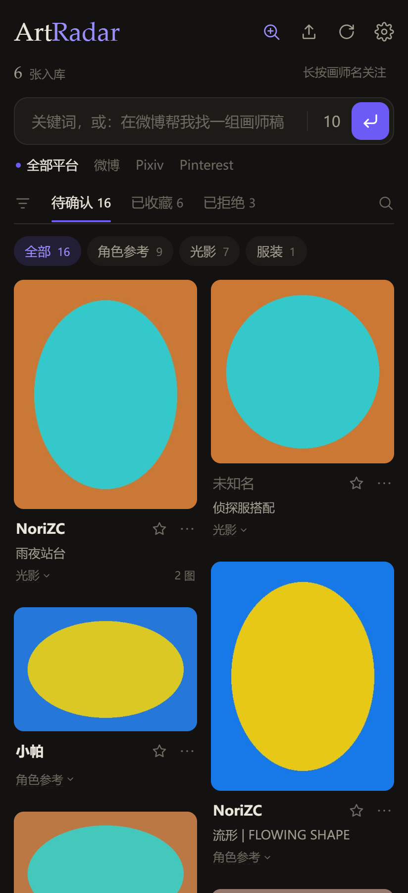
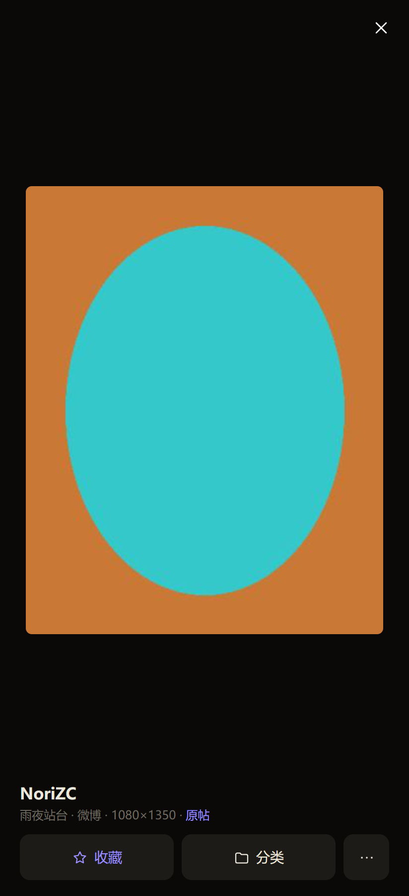
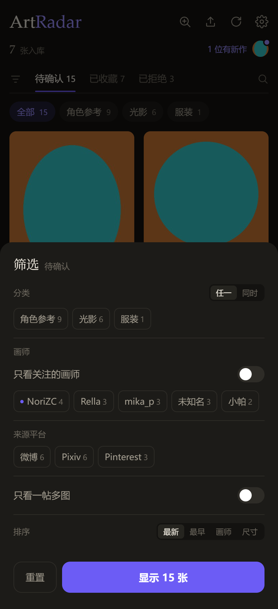

# ArtRadar

**每日绘画参考采集与归档工具** — 自动从 Pixiv、微博、Pinterest 收集绘画参考候选，在本地网页界面里快速确认、分类，归档成你自己的、按文件夹组织的参考图库。

A local-first art reference collector for Windows: scrape candidates from Pixiv / Weibo / Pinterest, review them in a local web UI, and file the keepers into your own folder structure.



## 特性

- **多来源采集**：Pixiv 日榜 / 新人榜 / 标签搜索 / 关注流，微博指定画师 + 关注列表自动发现，Pinterest 公开搜索，通用 RSS。
- **候选 + 今日精选**：每天定时抓取，候选进入待确认清单，超过保留天数自动过期。
- **本地网页界面**：瀑布流、分类筛选、本地搜索、多选批量操作、6 套配色主题；图片保持原比例，图上不叠任何按钮。
- **自动分类与去重**：按画师 / 标题 / 来源推断分类，pHash 感知哈希去重，再用缩略图的肤色、冷暖、明暗、长宽比补一次判断。
- **质量过滤**：近乎空白、严重模糊、压缩过度的图直接进「已拒绝」并标注原因。
- **安卓客户端**：同一 Wi-Fi 下浏览、分类、收藏、上传，带本地通知（非云推送）。
- **单文件 exe**：不需要预装 Python，双击即用。

| 大图浏览 | 筛选面板 |
|---|---|
|  |  |

## 下载

到 [Releases](../../releases) 下载 `ArtRadar.exe`（单文件，Windows 10/11 64 位）。

- 首次启动会解压到临时目录，约 5–10 秒。
- 抓取时的页面渲染使用系统已安装的 **Chrome**（Playwright 驱动已打进 exe，但浏览器本体需要本机有）。
- exe 默认带一份内置配置；如果 exe 同目录放一个 `config.toml`，会优先使用它。

> 默认配置里的图库路径是本机路径，第一次用请按下面「初次配置」改成你自己的目录。

## 初次配置

1. 新建一个图库目录，例如 `D:\Art\Reference`，在里面按分类建文件夹（`光影`、`动态`、`场景` 等，名字随意，改 `config.toml` 的 `[filing].tags` 对齐即可）。
2. 把仓库里的 [`config.example.toml`](config.example.toml) 复制到 exe 同目录，重命名为 `config.toml`。
3. 改这两处：

   ```toml
   [paths]
   root = "D:/Art/Reference"   # 你的图库根目录，用正斜杠

   [collect]
   proxy = ""                  # 需要代理才能访问 Pixiv 时填，如 "http://127.0.0.1:7890"
   ```

4. 双击 `ArtRadar.exe`，浏览器会自动打开 <http://127.0.0.1:8765/>。

第一次点「找新图」时如果弹防火墙提示，请允许**专用网络**（手机端需要局域网访问）。

## 使用

- **找新图 / 再来一组**：选平台（全部 / Pixiv / 微博 / Pinterest）、数量、关键词。留空走默认来源；含「微博」「Pixiv」「Pinterest」的自然语言会切换抓取策略；`@画师` 只搜该画师。
- **待确认 → 已收藏**：点图片看大图，点卡片文字或空白选中，多选后底部出现「收藏 / 存画师 / 分类 / 不要 / 删除」。
- **卡片操作**：`☆` 收藏、半身人形 存画师、红叉 拒绝、`⋯` 调整（分类、关注画师、只看这位画师、找更多作品、原帖、直接删除）。
- **分类**：点分类文字打开多选面板；虚线是自动建议，实线是人工分类。归档时优先进 `画师\<画师>`，识别不出的进「收藏」。
- **刷新 / 切换标签页不会丢滚动位置**，收藏、拒绝、分类这些操作就地更新。

## 命令行

```powershell
# 采集所有启用的来源
.\ArtRadar.exe collect

# 生成今日精选（默认 12 条）
.\ArtRadar.exe pick --n 12

# 看看待确认
.\ArtRadar.exe pending

# 归档第 3 条到画师目录 / 归档第 5 条到「光影」
.\ArtRadar.exe accept 3 --artist
.\ArtRadar.exe accept 5 --tag 光影

# 登记图库里已有的图片（按文件夹分类）
.\ArtRadar.exe scan
.\ArtRadar.exe stats
```

## 从源码运行

需要 Python 3.10+ 和 Chrome：

```powershell
pip install -r art-radar\requirements.txt
python art-radar\server.py --port 8765 --open
```

纯命令行（不开网页）：

```powershell
python art-radar\artradar.py collect
python art-radar\artradar.py pending
```

## 打包 exe

```powershell
pip install pillow pyinstaller playwright
powershell -ExecutionPolicy Bypass -File art-radar\build_exe.ps1
```

产物在 `dist\ArtRadar.exe`；`ui.html` 和 `config.toml` 会一起打进 exe，所以改完界面要重新打包。

## 手机端

`mobile\ArtRadarMobile.apk`（Android，WebView 壳）：

1. 手机和电脑连同一个 Wi-Fi。
2. 电脑打开 ArtRadar，点网页右上角 **⚙ 设置**，复制「手机端访问」地址。
3. 手机装 APK，把地址粘进「配对地址」，保存并连接。
4. 电脑防火墙首次弹窗时允许**专用网络**。

手机端是局域网本地通知，不是 FCM 云推送；PC 关机或换 IP 后需要重新配对。详见 [mobile/README.md](mobile/README.md)。

## 目录结构

```
ArtRadar.spec              PyInstaller 打包配置
art-radar/
  app.py                   exe 入口
  artradar.py              采集 / 归档 CLI
  server.py                本地 HTTP 服务
  ui.html                  网页界面（内嵌进 exe）
  config.example.toml      配置模板
  scripts/                 计划任务、代理检查等辅助脚本
  build_exe.ps1            打包脚本
mobile/                    Android 客户端源码与 APK
screenshots/               README 用截图
```

图库里每张图旁边会有一个同名 `.json`（记录来源、画师、原帖、标签、分辨率、采集时间），`.artradar\` 是隐藏工作区（索引、缩略图、待确认清单、浏览器登录态），不要手动改。

## 已知限制

- 收藏 / 拒绝之后的「撤销」还没做，误操作要去对应标签页恢复。
- 分类是「文件名 + 画面统计特征」的启发式，不是视觉大模型；人体崩坏这类问题仍需手动拒绝。
- `@画师` 目前固定走微博；Pixiv 画师搜索还不可用。
- 原图下载失败时会退化成预览图，并在 `.json` 里标 `low_res`，还没有批量补原图入口。
- 跨来源去重基于 pHash，对裁剪或加过水印的变体不敏感。
- 真机只在模拟器上验证过，物理机上的长按 / 滑动还需要再试。

## 隐私与免责

- 所有数据都在本机：图片存你的图库目录，索引和登录态存 `.artradar\`，不上传任何服务器。
- 采集频率很低（每源 10 条以内、下载间隔 1 秒），只抓公开内容；登录态保存在独立的 Chrome 配置里，不碰你日常使用的浏览器。
- 抓到的图仅供**个人参考**，请勿二次发布或商用；请遵守各来源站点的服务条款。
- 自动化访问有被限流或触发验证码的风险，出现验证时请在浏览器里手动通过。

## 致谢 / Special Thanks

Special Thanks to: 森岫Official & His almighty Cutex

see Cutex at: https://github.com/senxiu-official/cutex-desktop

## 许可

仓库目前没有 LICENSE 文件，默认保留所有权利。如果需要开放使用，建议补一个 MIT 或 Apache-2.0。
